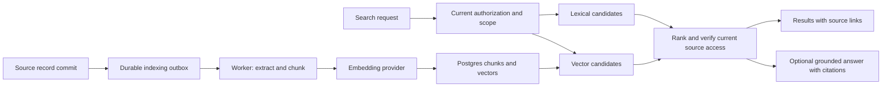

# Architecture, performance, and vector search review

Date: 2026-10-20

Status: review and recommendations requested by the project owner; not an accepted ADR.

Follow-up (20/10/2026): findings 2, 3 and the web half of 5 were fixed in `6849418` (ADR 0104 §6). Findings 1, 4, 5 (server half), 6, 7, 8 and 9 were fixed on branch `perf-review-fixes` (ADR 0105, migration 0127, and the SQL budgets section of `docs/runbooks/neon-compute-and-worker.md`). The contract-overdue, lead-scan and session sweepers also moved to the worker tick, and `tools/scripts/load-smoke.mjs` is the load harness. Not done by choice: request-abort SQL cancel (node-pg cannot cancel through the pooler; the `pv_api` 15 s statement budget bounds an abandoned request) and a Fly check on `/readyz` (a DB blip would mark every machine unhealthy at once). Still open: a load run on production-shaped data, which needs a Neon branch from the owner, and first-response metric plans from that run.

Reviewed revision: `adbe78e`, including the existing working tree. Initial architecture checks were run at `8ae8d19`; the subsequent fuzzy-search commit was inspected before publishing this report. Four home-page files already had local changes. No application source or production data was changed by this review, and no production load test was run.

This is a dated evidence snapshot. Source links identify files and symbols; line numbers refer to the inspected revision and will move as code changes. ADR 0104 is still marked built but not yet shipped in its text; actual deployment status was not independently verified.

**Recommendation:** retain the modular monolith, fix the correctness and reliability findings below, and keep PostgreSQL search for the current CRM. Defer a separate vector database. Evaluate `pgvector` inside the existing PostgreSQL deployment only for an explicit semantic-search or document-question-answering feature.

## Assessment

Keep the modular monolith and the separate API/worker processes. Shared contracts, pure decision engines, transaction boundaries, server-side scopes, and the mail outbox are appropriate foundations for this CRM. The inspected paths show deliberate batching and indexing.

The implementation is not yet demonstrated to meet a performance or availability target. The most actionable gaps are cache correctness, durable Calendar synchronization, query execution budgets, and operational measurements. User concurrency and projected data volume were not supplied during this review, so no capacity claim is made.

## Verification scope

- At `8ae8d19`, `pnpm test`: 18 files, 255 tests passed. This result does not certify the subsequent fuzzy-search change.
- At `8ae8d19` plus the existing home-page edits, `pnpm --filter @pv/web build`: passed in 10.44 seconds, with chunk-size warnings.
- Documentation verification: `pnpm ctx --strict` passed with the same 14 pre-existing warnings and no broken references; all 39 local Markdown links in the changed documentation resolved. The three documentation files passed formatting checks.
- A small check using the installed TanStack Query dependency fetched once, then remained stale after four times its configured `staleTime`. This corroborates the library documentation: freshness expiry does not schedule a fetch.
- The test file inventory covers fixtures, selected engine rules, mail parsing/classification, connection retries, health responses, and one schema test. It does not establish end-to-end coverage for cache propagation, Calendar recovery, or concurrent CRM writes.

## Foundations worth retaining

1. **Boundaries:** `platform`, business modules, shared Zod contracts, and React-free decision engines have explicit responsibilities and import restrictions. This supports consistent permission and business decisions across the system.
2. **API/worker separation:** one codebase and image, separate entrypoints and process groups. Heavy mail and scan consumers have their own process and concurrency settings.
3. **Mail outbox:** the delivery ledger is written with the business transaction; a relay discovers pending work. Atomic claims, event-key uniqueness, provider idempotency keys, retry limits, dead letters, and stuck-delivery recovery address several real failure windows. See [mail relay](../../apps/api/src/platform/queue/mail-relay.ts) (review line 64) and [mail consumer](../../apps/api/src/platform/queue/mail.consumer.ts) (review line 209).
4. **Read-path work:** lead books batch related labels/holds and page results. At `adbe78e`, independent reads run concurrently only without a search term; search reads share a transaction and run sequentially. KPI values combine requested series into a SQL statement rather than issuing a query per employee. Search uses trigram indexes; migration 0125 adds indexes for named access paths. These are structural improvements, not proof of their runtime performance at a given data size.
5. **Frontend:** lazy routes, intent prefetch, query cancellation signals, cache tiers, and cache clearing when identities change are useful controls.
6. **Push:** notifications share one direct Postgres listener per API process, with reconnect, verification, coalescing, and polling fallback. Entity payloads contain kinds rather than record identifiers, avoiding a direct scope leak.

## Findings

The priorities describe recommended work order. A confirmed code path is not a claim that a production incident has occurred.

| ID  | Priority | Classification              | Main location                                                         | Problem                                                            |
| --- | -------- | --------------------------- | --------------------------------------------------------------------- | ------------------------------------------------------------------ |
| 1   | High     | Recovery gap                | `MeetingService.drop`, `MeetingCalendar.push`                         | Calendar side effects can be lost or duplicated                    |
| 2   | High     | Correctness defect          | `meetingTodayQuery`, `cacheTier.live`                                 | Time-dependent data stops refreshing while push is connected       |
| 3   | High     | Correctness defect          | `KEYS_OF_KIND`, `cacheTier.aggregate`                                 | Business writes do not refresh dependent KPI data                  |
| 4   | Medium   | Configuration gap to verify | `createDb`                                                            | SQL and lock waits lack explicit repository-defined deadlines      |
| 5   | Medium   | Unmeasured scaling risk     | `NotificationListener.broadcast`                                      | Writes trigger refetches across all relevant active tabs           |
| 6   | Medium   | Work placement              | `KpiAlertSweeper`, `MeetingCancelSweeper`                             | Adding API replicas also adds background sweeps                    |
| 7   | Medium   | Unmeasured query cost       | `LeadRepository.book`, `KpiForecastService.weekly`, `readsUnderFloor` | Repeated aggregates, deep OFFSET, and serialized search reads      |
| 8   | Medium   | Verification gap            | request logger, CI, health checks                                     | No demonstrated load envelope or end-to-end recovery coverage      |
| 9   | High     | Search correctness defect   | `directProbe`, `probeBranch`                                          | An inaccessible direct match can suppress an accessible typo match |

### 1. Calendar synchronization can leave permanent mismatches

Priority: high. Confirmed failure paths in the implementation; external failures were not injected during this review.

- Booking and editing commit CRM data, then await `calendar.push`. A failure is returned as a transient outcome and is not stored as pending synchronization. Process death between commit and push also leaves no durable create/update work.
- Manual deletion removes the meeting row before attempting the Google deletion. `forget` can return `false`, which the cleanup wrapper does not treat as pending work. The cancellation sweeper only reads retained cancelled rows, so it cannot recover an already deleted meeting.
- Event insertion does not supply a stable Calendar event ID. If Google accepts an insertion but the response or the subsequent DB update is lost, another push can insert a second event. `conferenceData.createRequest.requestId` identifies conference creation, not the event itself.

Evidence: [booking and deletion flow](../../apps/api/src/branches/sales/meeting/meeting.service.ts) (review line 118), [delete before external cleanup](../../apps/api/src/branches/sales/meeting/meeting.service.ts) (review line 187), [push outcome](../../apps/api/src/branches/sales/meeting/meeting-calendar.ts) (review line 29), [Google insertion](../../apps/api/src/platform/google/google-calendar.client.ts) (review line 62).

Recommendation: record Calendar operations in a durable outbox within the business transaction. Retain deletion metadata until confirmed. Serialize/coalesce operations per meeting, preserve an operation version, and use a stable provider-compatible event ID with reconciliation after ambiguous responses. The API can return the saved meeting with its sync state; the worker completes the external operation. Google supports caller-supplied event IDs under specific constraints: [Calendar events.insert](https://developers.google.com/workspace/calendar/api/v3/reference/events/insert).

### 2. Push has replaced a clock that meeting data still needs

Priority: high for the next release. Confirmed code-path defect.

`meetingTodayQuery` uses `cacheTier.live(60_000)`, whose polling stops while SSE is live. The API filters meetings using the current time and returns only the next meeting plus a remaining count. When a meeting ends, or the Vietnam day changes, no row write is required and no entity event is emitted. A tab left open can retain an expired next-meeting result until a subsequent invalidation, focus/remount, or the stream's periodic reconnect. The frontend minute clock changes local rendering but does not fetch the next meeting.

Evidence: [query](../../apps/web/src/data/meeting-today.ts) (review line 21), [polling stop](../../apps/web/src/app/query-client.ts) (review line 44), [time-dependent selection](../../apps/api/src/branches/sales/meeting/meeting.repository.ts) (review line 60).

Recommendation: retain a session/visibility-aware timer for time-dependent reads, or schedule invalidation at the next relevant time boundary. Audit overdue badges and date-dependent aggregates using the same rule.

### 3. KPI freshness is not guaranteed by the current invalidation map

Priority: high for the next release. Confirmed dependency mismatch.

KPI values derive from leads, opportunities, contracts, meetings, and debriefs. The entity-to-query mapping invalidates `['sales', 'kpi']` only for the `kpi` kind; business-table events do not reach that prefix. `cacheTier.aggregate` supplies only `staleTime: 60_000`, so a continuously mounted KPI screen is not guaranteed to refresh after one minute. Normal stream reconnect eventually triggers a broad refresh, but that is a different freshness contract. With push unavailable, there is no aggregate poll here.

Evidence: [invalidation map](../../apps/web/src/data/entity-sync.ts) (review line 60), [aggregate cache tier](../../apps/web/src/app/query-client.ts) (review line 66), [KPI query](../../apps/web/src/data/kpi.ts) (review line 32), [KPI business dependencies](../../apps/api/src/branches/sales/kpi/kpi-readings.repository.ts) (review line 162).

Recommendation: explicitly map business events to dependent aggregate queries; apply a bounded refresh cadence to costly aggregates, including a fallback when push is unavailable. Test cross-user changes while the dashboard stays mounted. TanStack documents that periodic fetching uses `refetchInterval`, independently of `staleTime`: [Important Defaults](https://tanstack.com/query/latest/docs/framework/react/guides/important-defaults).

### 4. Query execution and lock waits have no explicit budget in the repository

Priority: medium; validate live database settings before treating this as a production defect.

The application pool has `max: 10`, a five-second connection/checkout timeout, and a 30-second idle timeout. These do not establish an SQL execution deadline. No application or repository configuration for `statement_timeout`, `lock_timeout`, or idle-in-transaction timeout was found. A slow query or lock waiter can therefore occupy scarce pool capacity unless the deployed database role already imposes limits. A disconnected HTTP client also does not visibly cancel repository SQL.

Evidence: [pool configuration](../../apps/api/src/platform/db/create-db.ts) (review line 67), [readiness probe](../../apps/api/src/platform/health/health.controller.ts) (review line 65).

Recommendation: inspect the effective production settings first; define separate execution/lock budgets for interactive requests, workers, and migrations, with controlled error responses. Measure pool wait and active/waiting connections before changing pool size. PostgreSQL distinguishes execution, lock, and idle transaction timeouts: [Client Connection Defaults](https://www.postgresql.org/docs/current/runtime-config-client.html).

### 5. Entity broadcasts can amplify reads as active users grow

Priority: medium; a scaling risk, not a measured current bottleneck.

Every entity kind is broadcast to every subscribed actor. Coalescing limits events per stream, but each receiving tab invalidates all active matching query prefixes. The aggregate cache freshness window does not shield a query from explicit invalidation. Under sustained writes, read work grows with the number of active relevant tabs and their active queries.

Illustration only: 50 active tabs with three matching queries can issue roughly 150 refetches per second if each receives a relevant coalesced event every second. This is not a measured application rate or a capacity estimate.

Evidence: [broadcast](../../apps/api/src/platform/notification/notification.listener.ts) (review line 140), [one-second coalescing](../../apps/api/src/platform/notification/notification.stream.ts) (review line 10), [active refetch](../../apps/web/src/data/entity-sync.ts) (review line 106).

Recommendation: measure GET fanout per write, then coalesce aggregate refreshes, add jitter where appropriate, and introduce authorization-aware subscriptions if growth justifies them. Keep record identifiers private until the routing layer can enforce scope.

### 6. Some sweepers execute in API processes as well as the worker

Priority: medium.

`KpiAlertSweeper` and `MeetingCancelSweeper` start at boot and on intervals whenever `NODE_ENV` is not `test`. Their modules are in the shared application graph. Adding API replicas therefore adds KPI computation and Calendar cleanup passes. Claim/idempotency logic limits duplicate effects but does not eliminate repeated queries and external requests. The Calendar sweep has neither a batch bound nor a local overlap guard.

Evidence: [KPI timer](../../apps/api/src/branches/sales/kpi/kpi-alert.sweeper.ts) (review line 56), [Calendar timer and shared module](../../apps/api/src/branches/sales/meeting/meeting-cancel.sweeper.ts) (review line 31), [unbounded cancellation read](../../apps/api/src/branches/sales/meeting/meeting.repository.ts) (review line 206).

Recommendation: move scheduled work to worker-only wiring; use bounded batches and a job claim/lease when multiple workers are allowed. Retain effect-level idempotency. This makes scaling the HTTP tier independent of scheduling work.

### 7. Reporting and fuzzy-search query shapes need representative plans

Priority: medium; optimization candidates, not confirmed slow queries.

- Lead books execute one or two exact counts plus a page query, then batch related data. Deep pages use OFFSET. Cost can rise with filtered row count and page depth.
- The new fuzzy-search helper runs a direct-match probe and sets transaction-local thresholds. With a search term, `readsUnderFloor` executes the count/page reads sequentially on one connection. This preserves the shared search mode but adds round trips and extends the connection hold. Benchmark search separately from unfiltered browsing; the earlier parallel-read optimization does not apply to this path. See [fuzzy.ts](../../apps/api/src/platform/db/fuzzy.ts), `withFuzzyFloor` and `readsUnderFloor`.
- Weekly KPI charts issue up to five or six cumulative reads from the beginning of the month. Parallelism reduces waiting but repeats database work.
- The first-response metric derives historic handovers and uses a lateral exchange lookup. One round trip can still contain substantial work.

Evidence: [lead book reads](../../apps/api/src/branches/sales/lead/lead.repository.ts) (review line 218), [weekly repeated reads](../../apps/api/src/branches/sales/kpi/kpi-forecast.service.ts) (review line 123), [first response metric](../../apps/api/src/branches/sales/kpi/kpi-readings.repository.ts) (review line 132).

Recommendation: capture representative query plans and timings first. For additive weekly metrics, compare a single weekly aggregation with a cumulative window. Consider cursor pagination for deep traversal and aggregate projections only where measurements justify the additional consistency work.

### 8. Operational and regression evidence is incomplete

Priority: medium, foundational to performance decisions.

The API logs completed requests above 300 ms. This does not by itself give route-level p50/p95/p99, SQL timing, pool queue time, queue oldest-job age, or event-loop lag. No load-test harness or application metrics instrumentation was located. Live infrastructure may have external monitoring, which was not inspected. Fly's configured check is `/livez`; `/readyz` exists, but external readiness alerting is not demonstrated by the repository.

The current tests pass but do not cover the identified cross-system failure windows or real concurrent transaction behavior. CI is useful evidence for its tested rules, not a throughput or full-system correctness result.

Evidence: [slow-request logger](../../apps/api/src/main.ts) (review line 138), [Fly health check](../../apps/api/fly.toml) (review line 102), [CI](../../.github/workflows/ci.yml) (review line 21).

Recommendation: instrument latency and saturation, establish workload-specific objectives, and add targeted integration tests for the findings. Exercise simultaneous edits, duplicate job delivery, lost external responses, and reconnect after missed events against a disposable PostgreSQL environment.

### 9. Fuzzy fallback is decided using records outside the viewer's scope

Priority: high for search correctness. Confirmed in the SQL construction and reproduced with synthetic data in an isolated in-memory PGlite database using `pg_trgm`.

`directProbe` deliberately excludes scope and filters. Global search's `probeBranch` supplies the branch's FROM and text columns, but omits its visibility fence. `withFuzzyFloor` then turns typo matching off if that unscoped probe finds a direct match. The final result query does enforce scope, so it can discard the direct match after it has already suppressed the visible typo candidates.

Reproduction of the same SQL policy:

- The viewer owns a record titled `northwimd`; another user owns `northwind`.
- Query: `northwind`, threshold `0.5`. The inaccessible direct hit turns typo fallback off; the viewer receives no record.
- Remove only the inaccessible row from the synthetic dataset. The same query now returns the viewer's `northwimd` record.
- The viewer's data and permission are unchanged, yet the result changes because of inaccessible data. This demonstrates a false negative and an observable scope dependency, not a demonstrated disclosure of the hidden record's contents.

Evidence: [fuzzy.ts](../../apps/api/src/platform/db/fuzzy.ts), `directProbe` and `withFuzzyFloor`; [search.branches.ts](../../apps/api/src/branches/sales/search/search.branches.ts), `probeBranch` (review line 201) and `searchBranch` (review line 171).

Recommendation: decide fallback within the viewer's permitted universe. Keep the same scoped search decision for the book, counts, and facets; define deliberately whether optional UI filters also participate. Add a regression case with a hidden direct hit and a visible typo hit. A vector database would not correct this scope-policy error.

## Frontend build observation

The build measured at `8ae8d19` reports an entry `index` chunk of 616.32 kB minified / 190.89 kB gzip. Other large chunks include HEIC conversion (1,352.90 / 341.25 kB), map code (784.61 / 213.32 kB), PDF code (483.14 / 144.26 kB), and rich mail content (359.86 / 111.61 kB). Their presence alone does not mean every screen downloads all of them; routes and several features use dynamic imports.

The configured 400 kB chunk threshold emits a warning, while CI only lists asset sizes. It is not an enforced failure budget. Inspect an actual initial-load network trace and module composition before selecting code splits. These figures are historical build observations, not a current CI budget or browser loading measurement.

## Recommended order

1. Fix the meeting clock, dependent KPI invalidation, and scoped fuzzy fallback before treating these new search/push paths as ready.
2. Make Calendar work durable and recoverable, using the existing mail outbox design as a reference.
3. Establish latency/queue/pool measurements and effective SQL budgets; keep scheduled work in workers.
4. Run a representative mixed workload on isolated PostgreSQL, including active SSE tabs and background mail/scan work. Use production-shaped data cardinalities and distributions supplied by the owner.
5. Optimize the measured dominant paths; enforce a realistic initial-load bundle budget and protect corrected behavior with targeted integration tests.

No requests-per-second, concurrent-user ceiling, or production p95 can be responsibly assigned from this static review and unit/build checks alone.

## Vector database suitability

### Recommendation for this product

**Do not add a separate vector database for the current workload.** Continue using relational SQL and the existing accent-folded trigram search. Introduce vector retrieval only when a named feature needs meaning-based search across unstructured text and an evaluation shows useful improvement.

If that feature is approved, start with an isolated pilot of **pgvector in the existing PostgreSQL/Neon environment**. Neon documents support for the extension; this review did not check whether it is installed in the deployed database. That keeps a first implementation near source records and their current permission rules. [Neon pgvector documentation](https://neon.com/docs/extensions/pgvector)

This is a recommendation, not authorization to install an extension, send customer content to an embedding provider, or deploy a search service.

### Evidence from the current repository

| Existing behavior                                                                                         | Location                                                                                                                                                                                      | Implication                                                                                      |
| --------------------------------------------------------------------------------------------------------- | --------------------------------------------------------------------------------------------------------------------------------------------------------------------------------------------- | ------------------------------------------------------------------------------------------------ |
| Search ranks codes, names and contact details, with accent folding and typo fallback                      | [fuzzy.ts](../../apps/api/src/platform/db/fuzzy.ts), [search.branches.ts](../../apps/api/src/branches/sales/search/search.branches.ts)                                                        | Improve this path for record lookup; embeddings add no demonstrated value to exact identifiers   |
| Search filters permitted object kinds and applies per-record ownership scope                              | [search.service.ts](../../apps/api/src/branches/sales/search/search.service.ts), `viewable`; [search.branches.ts](../../apps/api/src/branches/sales/search/search.branches.ts), branch fences | Any new retrieval route must preserve both permission levels                                     |
| Current model use reads a supplied card/profile file and extracts structured fields                       | [gemini.scan-reader.ts](../../apps/api/src/platform/ai/gemini.scan-reader.ts), `read`; [ai.module.ts](../../apps/api/src/platform/ai/ai.module.ts)                                            | This extraction workflow has no demonstrated need for a persistent vector index                  |
| Communication metadata and message/summary content have different permissions                             | [thread.service.ts](../../apps/api/src/platform/comms/thread.service.ts), `messages`; [debrief contract](../../packages/contracts/src/comms/debrief.ts), `comm.view-content`                  | Record visibility alone cannot authorize embedding-derived snippets or answers                   |
| No embedding storage or retrieval/indexing pipeline was identified in the inspected search and AI modules | the modules above                                                                                                                                                                             | Vector adoption would introduce an ingestion and retrieval subsystem, not just another SQL index |

PostgreSQL's `pg_trgm` supports string-similarity operators and indexes, including indexed LIKE/ILIKE patterns. That fits spelling variation and substring lookup; it does not establish semantic similarity between business concepts. [PostgreSQL pg_trgm documentation](https://www.postgresql.org/docs/current/pgtrgm.html)

### Which questions need which mechanism?

The examples below are illustrative product queries, not claims about existing customer data.

| Product task                                                                         | Recommended mechanism                                                   | Vector value                                                                       |
| ------------------------------------------------------------------------------------ | ----------------------------------------------------------------------- | ---------------------------------------------------------------------------------- |
| Find a lead by code, tax identifier, phone, email or company spelling                | Relational predicates plus existing folded/trigram search               | Low; protect exact-match behavior                                                  |
| Find overdue contracts or calculate revenue/KPI totals                               | Authorized SQL and existing domain services                             | None for the authoritative answer                                                  |
| Read contact fields from an uploaded business card/profile                           | Existing extraction reader and schema validation                        | No persistent retrieval index needed for this step                                 |
| Summarize the selected customer's already-known recent records                       | Authorized reads of that customer's records, then bounded summarization | Optional; useful only if selecting relevant passages becomes difficult             |
| Find conversations expressing deployment concerns without using that exact phrase    | Hybrid lexical and semantic retrieval over authorized text              | Potentially useful; validate on Vietnamese CRM queries                             |
| Answer questions about approved manuals or product documents, with passage citations | Retrieval-augmented generation over a curated corpus                    | A suitable first pilot if users need it                                            |
| Suggest similar past opportunities or examples of objections                         | Semantic candidates plus structured constraints and human review        | Potentially useful; similarity must not become a business verdict                  |
| Detect duplicate customers                                                           | Existing identity/admission rules first                                 | Optional candidate suggestion only; never automatically merge by vector similarity |

### Why adoption now would add work without fixing the findings

A vector index does not repair cache invalidation, Calendar delivery, SQL lock waits, scope selection, or worker placement. Those remain independent requirements.

The additional work includes text extraction and chunking, embedding generation, source/version tracking, reindexing when models change, updates/deletes, permission enforcement, latency instrumentation, and relevance evaluation. A separate service also introduces another copy of searchable data and a synchronization boundary.

There is no measured corpus size, semantic query demand, or lexical-search relevance baseline in this review that establishes a benefit large enough to justify that work now. This is a product-specific inference from the inspected implementation.

### Proposed pilot design, if a semantic feature is approved

Use a small, approved document corpus or permission-checked debrief summaries. Choose one feature and evaluate it before indexing all CRM content.

This is a proposed application design, not a description of implemented code.

1. **Source remains authoritative.** Store chunk identity, source kind/ID, source version or content hash, chunk position, model ID, dimensions, and indexing time. Retain source links for citations. Embeddings are a rebuildable derived representation.
2. **Index asynchronously.** Write an indexing intent with the source transaction, then let a worker call the embedding provider outside that transaction. Reject an outdated job's result if the source version changed. Deletes/tombstones and model migrations need explicit handling.
3. **Use current permissions.** Apply server-side record scope and content permissions to candidate retrieval. Recheck current source visibility/version before exposing snippets or sending context to a model. An asynchronously copied owner/ACL field is insufficient after reassignment or revocation. Preserve existing content-read audit requirements.
4. **Keep query routes purposeful.** Identifiers and numerical reports use their existing deterministic read paths. For semantic queries, combine authorized lexical and vector candidates, then rank them. The language model receives only allowed passages and uses source citations; retrieved text is data, not authority to issue actions.
5. **Evaluate language quality.** Compare multilingual embedding candidates on real Vietnamese phrases, company abbreviations, mixed English/Vietnamese terms, and near-miss names. If adding PostgreSQL full-text search, evaluate its tokenization/configuration for this corpus rather than assuming English stemming works.
6. **Start with exact vector search for a small pilot.** Use it as the vector-neighbor baseline; add an approximate index only when measurements justify it. Exact nearest-neighbor recall refers to vector distance, not guaranteed business relevance.

The pgvector documentation distinguishes exact search from approximate indexes, which trade recall for speed. It also notes that approximate-index filtering can leave fewer matching results; iterative scans can search further within limits. A narrow authorization scope therefore needs explicit recall/latency evaluation even when the SQL filter is correct. [pgvector indexing and filtering](https://github.com/pgvector/pgvector#filtering)

### Adoption gates and operating cost

Before rollout, build a judged set of roughly 50–100 representative queries as a starting evaluation set, expanding it if important roles or query types remain uncovered. Compare the current lexical baseline against the proposed hybrid system on held-out queries.

Record:

- Relevant-result quality at the displayed result count, plus exact-identifier regressions.
- Permission correctness across restricted content, ownership transfer, disabled records and revoked roles. Unauthorized snippets or model context fail the release gate.
- Source freshness after edits/deletion and recovery after worker/provider outages.
- End-to-end p95 latency, embedding/indexing lag, and interference with normal CRM reads/writes at an agreed workload.
- Cost of initial and incremental embeddings, vector/index storage and memory, backup, worker compute, and optional reranking/generation.

For rough sizing, derive chunk count from measured documents and chunking behavior; calculate embedding input volume from the actual source text. Avoid converting the repository's code-line count or lead count directly into a vector-store estimate. No cost or capacity target is asserted without those measurements.

Adopt the pilot only if it solves a confirmed semantic use case better than lexical search and meets the agreed quality, freshness, authorization, latency and operating-cost requirements.

### When a separate vector service becomes reasonable

Revisit a separate service when representative measurements show that vector workloads materially interfere with transactional CRM traffic, when index scale or ingestion requirements exceed the practical deployment envelope, or when independent availability/scaling requirements justify another service. Evaluate the required synchronization and authorization behavior as part of that decision.

No universal document-count threshold is appropriate here: dimensions, chunk count, updates, filter selectivity, concurrency, index settings and latency goals all matter. The recommended first candidate remains pgvector; a separate vector database is deferred until evidence requires that separation.
